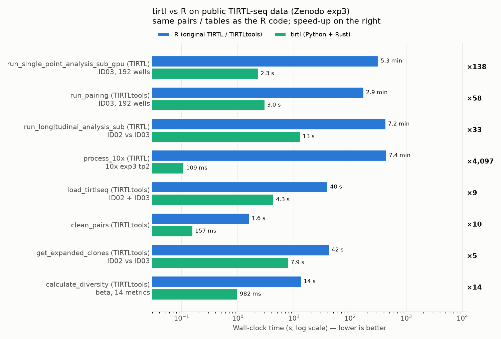

# tirtl: TIRTL-seq paired TCR analysis in Python (Rust backend)
Code for paired TCR data analysis from TIRTL-seq experiments. Please see the [paper](https://www.nature.com/articles/s41592-025-02907-9) for details. Data for the manuscript is available at Zenodo [](https://doi.org/10.5281/zenodo.14010377).

`tirtl` is a Python package that reproduces:
* the original TIRTL R pipeline: MAD-HYPE + T-SHELL pairing, pseudobulk, and the multi-run analyses;
* the pairing, data-processing and diversity functions of the [TIRTLtools](https://github.com/NicholasClark/TIRTLtools) R package (0.2.9).

It gives the same pairs and tables as the R code. The heavy steps run in Rust (multi-threaded CPU), and NVIDIA (cupy) and Apple Silicon (mlx) GPUs can be used for the dense correlation products.



## Installation
A Rust toolchain ([rustup](https://rustup.rs)) is needed to build the extension:
```bash
pip install -e .            # or: pip install maturin && maturin develop --release
pip install cupy-cuda12x    # optional, NVIDIA GPU
pip install mlx             # optional, Apple Silicon GPU
```
Requirements: Python >= 3.9, numpy, pandas, scipy (pyarrow recommended).
Without the compiled extension a pure-Python fallback is used (same results, much slower).
With a conda CUDA toolkit, cupy needs `CUDA_PATH=$CONDA_PREFIX/targets/x86_64-linux`; the package sets it automatically when it is missing.

## Quick start
The notebook [`tutorial.ipynb`](tutorial.ipynb) walks through the package on the public data of the paper (Zenodo, experiment 3: ID03, ID02 and 10x).

```python
import tirtl
res = tirtl.run_single_point_analysis_sub_gpu(
    "exp3_clones/TCR_clones_ID03/", prefix="cd8_tp2",
    wellset1=tirtl.get_well_subset(range(1, 17), range(1, 13)))   # first 12 columns of the plate
res["method"].value_counts()   # madhype 16369, tshell 9891 (identical to the R pipeline)
```
The parameters and the `{prefix}_TIRTLoutput.tsv` columns are those of the original R function (see below).
The flat module `tirtl_functions.py` keeps working (`import tirtl_functions as tf`). It is backed by the package.

The function also takes these optional parameters:

| parameter | meaning |
|---|---|
| `engine="auto"` | `"sparse"`: fused Rust MAD-HYPE + T-SHELL kernel over shared wells (default when Rust is available, CPU). `"dense"`: float32 matrix products on `backend`, then exact float64 re-scoring |
| `backend="numpy"` | `numpy` / `cupy` / `mlx`, used by the dense engine. Every backend gives byte-identical output; if a GPU library is missing, numpy is used with a warning |
| `cpw=None` | cells per well for MAD-HYPE (default: QC clone threshold, as in R) |
| `write_intermediates=False` | also write `{prefix}_bigmas.tsv`, `_bigmbs.tsv`, `_mdh.tsv` and the name files (original formats) |

## TIRTLtools functions
These functions have the same names, arguments and output tables as the TIRTLtools R package:
```python
tirtl.run_pairing(["plate1/", "plate2/"], "results/", "sample1", wellset=[wells1, wells2],
                  tshell_settings=tirtl.get_tshell_settings("96_well"))   # one sample over several plates
ds = tirtl.load_tirtlseq("results/", meta_columns=["donor", "timepoint"])
ds = tirtl.clean_pairs(ds)
tirtl.get_pair_stats(ds); tirtl.summarize_data(ds); tirtl.get_all_tcrs(ds, "paired")
tirtl.calculate_diversity(ds, chain="beta")
tirtl.get_expanded_clones(ds.data["d1_tp1"], ds.data["d1_tp2"])
```
* Filters: `filter_mait`, `filter_nonfunctional_TCRs`, `filter_short_cdr3s`, `remove_duplicates`.
* Sample handling: `filter_dataset`, `combine_TIRTLseqData`, `add_metadata`.
* Other: `get_paired_by_read_fraction_range`, and `create_thimble_df` / `write_stitchr_tsv`.

The original TIRTL multi-run analyses are faithful to the R code and vectorised:
* `run_longitudinal_analysis_sub`, `merge_TIRTL`, `add_sign`;
* `concordance`;
* `process_10x` / `get_clonotypes_10x`.

TCRdist and TCR clustering are not part of this package. Use dedicated packages, for example tcrdist3 or python-igraph / leidenalg, on the paired tables (`get_all_tcrs(ds, "paired")`).

## Differences from the original R code
* **T-SHELL correlations are computed in float64.** R's numpy backend uses float32; the float64 value is exact and does not depend on the backend.
* **Where float32 changes R's result.** On rare occasions R's float32 rounding changes a T-SHELL call. Two known cases:
  * two correlations differ by less than about 1e-5 at the 3rd/4th place of the top-3;
  * the float32 correlation rounds above 1 (e.g. `1.0000004`), which gives `NaN` p-values in R and drops all T-SHELL pairs of that alpha.
* **The earlier Python port of this repository differed from R, and is now aligned with it:**
  * extra `score > 0.1` clause in the T-SHELL filter;
  * `pval_adj` fallback when fewer than 3 p-values;
  * bisection instead of `uniroot`;
  * alphabetical instead of first-appearance row order;
  * file order and V/J tie-breaking not following R's collation.
* **Upstream behaviours kept on purpose.** `filter_short_cdr3s` reproduces TIRTLtools, which uses only the alpha flag.

## Tests
```bash
pytest tests                                   # unit + synthetic end-to-end tests (MAD-HYPE tables vs R, kernels, backends, TIRTLtools functions)
python tests/check_backends.py <mixcr_folder>  # all available backends give identical output (e.g. on a Mac for MLX)
```

### Input for pairing pipeline
The input data should be a folder with TCRalpha and TCRbeta repertoires from one plate in separate tab separated files from standard _mixcr_ output. Filenames should contain alphanumeric well id in the format "A1", "B2", etc separated by underbars.

Other parameters are optional and can be set to change the default behavior of the pipeline:

_prefix_ (default="tmp") - prefix for the output files

_well_filter_thres_ (default=0.5 of mean number of unique clones across alpha wells) - threshold for the number unique clones in a well to be considered as a valid well. Decreasing this threshold will increase the number of wells considered as valid, but may also increase the number of false positives.

_min_reads_ (default=0) - minimum number of reads a clone to be included. By default all clones are included. Increase this number if you suspect cross-contamination between wells or high number of sequencing errors. 

_well_pos_ (default=3) - position of the well id in the file name if split by underbar. For example, if the file name is "3123233_MVP093_TIRTLseq_**A1**_S8.alpha_old_ID10.clones_TRA.tsv", the well_pos should be 4.

_wellset1_ (default=get_well_subset(range(1,17), range(1,25))) - subset of wells to be analyzed (if you loaded your sample to part of the plate). By default all wells in 384 well plate are analyzed. For example, to analyze the first 12 columns of a 384-well plate, you can use get_well_subset(range(1,17), range(1,13)).

_compute_ (default=True) - whether to run the pairing. With False, the results of a separately run backend (_prefix_madhyperesults.csv_, _prefix_corresults.csv_) are read.

_backend_ (default="numpy") - array backend of the dense engine: "numpy" (CPU), "cupy" (NVIDIA GPU) or "mlx" (Apple Silicon GPU).

_wij_thres_tshell_ (default=2) - threshold for the number of wells with both alpha and beta chains for T-SHELL method. Increasing this number will increase the stringency of the pairing, but may also decrease the number of pairs found. Recommended value for 96-well experiments is 3.

_pval_thres_tshell_ (default=1e-10) - p-value threshold for the T-SHELL method. Recommended value for 96-well experiments is 1e-3.

_pseudobulk_ (default=False) - this option generates pseudobulk files, a single file containing all merged TCRalpha and TCRbeta singlechain data aggregated across wells. Resulting files are written out with _pseudobulk_TRA.tsv and _pseudobulk_TRB.tsv suffixes.

### Output for pairing pipeline
This will take TCRalpha and TCRbeta repertoires from the folder "data/" and pair them using the default parameters. The output will be saved in the working directory under _tmp_TIRTLoutput.tsv_ and also returned as a pandas DataFrame.

_wi_ - number of wells where alpha is found, but not beta

_wj_ - number of wells where beta is found, but not alpha

_wij_ - number of wells where both alpha and beta are found

_wa_ - number of wells where alpha is found

_wb_ -number of wells where beta is found

_alpha_nuc_seq_, _alpha_nuc_ - alpha CDR3nuc sequence

_beta_nuc_seq_, _beta_nuc_ - beta CDR3nuc sequence

_alpha_beta_ - alpha-beta pair concatenated nucleotide sequence

_method_ - method used for pairing t-shell, or MAD-HYPE

_r_ - for t-shell, the Pearson correlation coefficient between alpha and beta frequencies

_ts_ - for t-shell, the t-statistic of the correlation

_pval_ - for t-shell, the p-value of the correlation

_pval_adj_ - for t-shell, the adjusted p-value of the correlation

_loss_a_frac_ - the fraction of wells with lost alpha chain

_loss_b_frac_ - the fraction of wells with lost beta chain

_score_ - for MAD-HYPE, the score of the pairing (higher is better)

_cdr3a_ - alpha CDR3aa sequence

_va_ - alpha V gene

_ja_ - alpha J gene

_cdr3b_ - beta CDR3aa sequence

_vb_ - beta V gene

_jb_ - beta J gene

### Running on your own data
To run the pipeline on your own data, you need to have TCRalpha and TCRbeta repertoires processed with _mixcr_ (v. >= 4.6) separate for each well. 

We use the following mixcr pipeline for each well: 
```bash
$MIXCR analyze generic-amplicon --species hsa --rna \
--tag-pattern "^N{0:1}(SAMPLE:N{7})(R1:*)\^(R2:*)" \
--floating-left-alignment-boundary \
--floating-right-alignment-boundary C \
--split-by-sample \
--sample-sheet plate_index.tsv \
${fp}_L{{n}}_R1.fastq.gz ${fp}_L{{n}}_R2.fastq.gz \
$OUTDIR/${sample} \
--use-local-temp
```
where _plate_index.tsv_ is a tab separated file containing you PCR I plate indices (see example in this repo!). 

_MIXCR_ variable contains path to _mixcr_ executable.

_fp_ is the path to the fastq files for given wells without the _L{n}_R1.fastq.gz and _L{n}_R2.fastq.gz suffixes.

_OUTDIR_ is the output directory for the mixcr output.

_sample_ is the file name for the output for the given well (usually only filename from _fp_).


